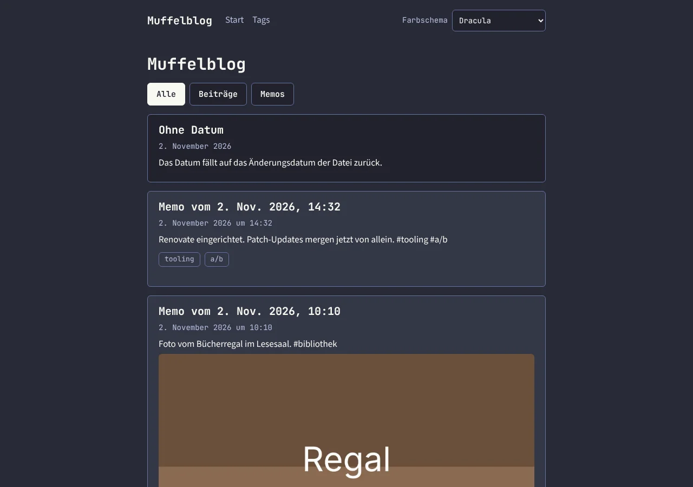
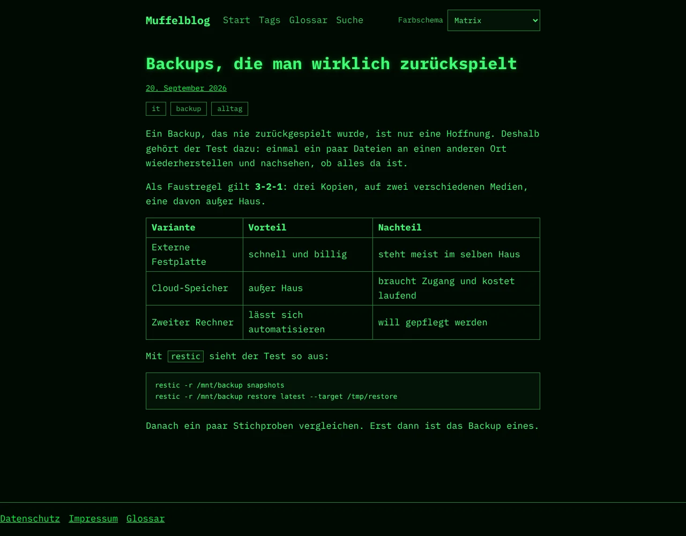

# Muffelblog

A personal blog that publishes from **Nextcloud** (long posts and glossary terms
as Markdown, Obsidian works well) and **Memos** (short notes). A permanent
builder turns both into a fast static site with search, RSS, a glossary, themes
and self-hosted comments (Remark42, login by email). It runs with Docker Compose
on your own server.

**Documentation:** https://heiss.github.io/muffelblog/ (quickstart, tutorial,
guides, production, reference; source in `apps/docs`). You can also let an AI
agent do the installation with you: see
[Install with an AI agent](https://heiss.github.io/muffelblog/start/agent-install/).

The specification is an OKF bundle in [`okf/`](okf/index.md). Development is in
English ([language rules](okf/ops/language.md)); the language of the site is a
setting (`MUFFEL_LANG`, `en` by default or `de`).

## What it does

- **Content:** posts, memos and glossary terms in one feed with filters, tags,
  endless scroll that also works without JavaScript, full-text search in the
  browser (Pagefind), RSS with full text, sitemap, microformats.
- **Comments:** Remark42 with login by email, notification mails, moderation on
  the command line, backup and restore; the comments are also part of the page.
- **Operation:** the builder checks the sources (default every 3 minutes), builds
  only after a change, switches releases atomically, keeps the last good version
  online when something fails, and reports through a log, a status file
  and an optional webhook.
- **Webmentions:** sending, off by default. Receiving is planned.
- **Safe by default:** sanitized content, a strict Content Security Policy, no
  foreign requests from the browser, ports on `127.0.0.1`, nothing leaves the
  instance unless you switch it on.

## Preview

With demo content (IT, photography, timber construction; the images are
placeholders), built with the German interface (`MUFFEL_LANG=de`) because the
demo content is German. There are ten color schemes, the default is Solarized
Light.

| Feed, Solarized Light                          | Feed, Dracula                                   |
| ---------------------------------------------- | ----------------------------------------------- |
|  |  |

| Feed mobile                                      | Article                                   | Article, Matrix                                         |
| ------------------------------------------------ | ----------------------------------------- | ------------------------------------------------------- |
|  |  |  |

| Tags                                |
| ----------------------------------- |
|  |

The images are taken from the built site with sample data and can be
regenerated with `pnpm screenshots` (needs a browser, see below).

## Structure

| Path            | Content                                           |
| --------------- | ------------------------------------------------- |
| `apps/site`     | Astro site                                        |
| `apps/builder`  | Scheduler, Nextcloud sync, releases, webmentions  |
| `apps/docs`     | Documentation site (Starlight, GitHub Pages)      |
| `packages/core` | Shared code of site and builder                   |
| `examples/`     | Example Nextcloud folder for the tutorial         |
| `docker/`       | Caddyfile and scripts (moderation, backup, tests) |
| `okf/`          | Specification, roadmap, decisions                 |

## Requirements

- Node 26 (see `.node-version`)
- pnpm 10 (version in `package.json`)

Corepack has not been part of Node since version 25. Install pnpm for example
with `npm install --global pnpm@10.28.0`.

## Commands

```sh
pnpm install              # dependencies
pnpm lint                 # ESLint
pnpm format:check         # Prettier (pnpm format writes)
pnpm typecheck            # tsc and astro check
pnpm test                 # unit tests (Vitest)
pnpm build                # build the site
pnpm test:e2e             # E2E tests (Playwright) against apps/site/dist
pnpm check                # lint, format:check, typecheck, test and build
pnpm dev:demo             # dev server with the demo content (IT, photography, timber)
pnpm screenshots          # regenerate the README images (docs/screenshots)
```

The E2E tests need a browser for Playwright:
`pnpm --filter @muffelblog/site exec playwright install chromium`.
Alternatively, `CHROMIUM_PATH` can point to an existing Chromium.

## Docker

```sh
docker build --target site-dist --output type=local,dest=out .
```

This writes the built site to `out/`.

### Try it locally with Docker Compose

Needs Docker with Compose. The stack serves the demo set (no Nextcloud, no
Memos needed).

```sh
docker/init-env.sh --demo       # .env with random secrets, local addresses and the demo
docker compose up --build       # builds the images here and starts everything
```

| What                       | Where                 |
| -------------------------- | --------------------- |
| Site                       | http://localhost:8080 |
| Comments server (Remark42) | http://localhost:8081 |
| Mail sink (Mailpit)        | http://localhost:8025 |

The ports listen on `127.0.0.1` only. `MUFFEL_BIND=0.0.0.0` in `.env` opens them
to the network.

The `builder` builds the site into a new release folder and switches the link
`current` atomically. It keeps running: every `MUFFEL_CHECK_INTERVAL_SECONDS`
(default 180) it checks Nextcloud and Memos and builds again after a change
(see `.env.example`); the status is in `/data/state/status.json`. `web` (Caddy) serves
that release with a strict Content Security Policy. Stop with
`docker compose down` (add `--volumes` to delete the data). Ports and further
settings are in `.env.example`.

`docker/smoke.sh` checks a running stack; CI runs it on every code change.

### Production

`compose.yaml` is the production setup behind your reverse proxy:

```sh
docker/init-env.sh              # .env with random secrets; fill in the required values
docker compose up -d
```

Your proxy adds HTTPS and forwards the blog host to `127.0.0.1:8080` and the
comments host to `127.0.0.1:8081`. Steps, the required variables and proxy
snippets: [Getting started](https://heiss.github.io/muffelblog/start/getting-started/).
If your proxy must serve the files itself, see `compose.host-folder.yaml`.

### Releases

A Git tag like `26.11.0` (year.month.counter, no `v`) runs the whole CI again and
only then publishes `ghcr.io/heiss/muffelblog-builder:<tag>` (amd64 and arm64)
and creates a GitHub release. `docker compose up` then uses the published image
(`MUFFEL_VERSION` selects the tag). A new GHCR package is private until you make
it public in its settings on GitHub.

## CI

`.github/workflows/ci.yml` checks every pull request. The **CI Gate** job is the
required check for `main`. Changes only to `okf/` and to Markdown files in the
root directory skip the heavy checks.

## License

[MIT](LICENSE), copyright 2026 Muffelblog contributors.
