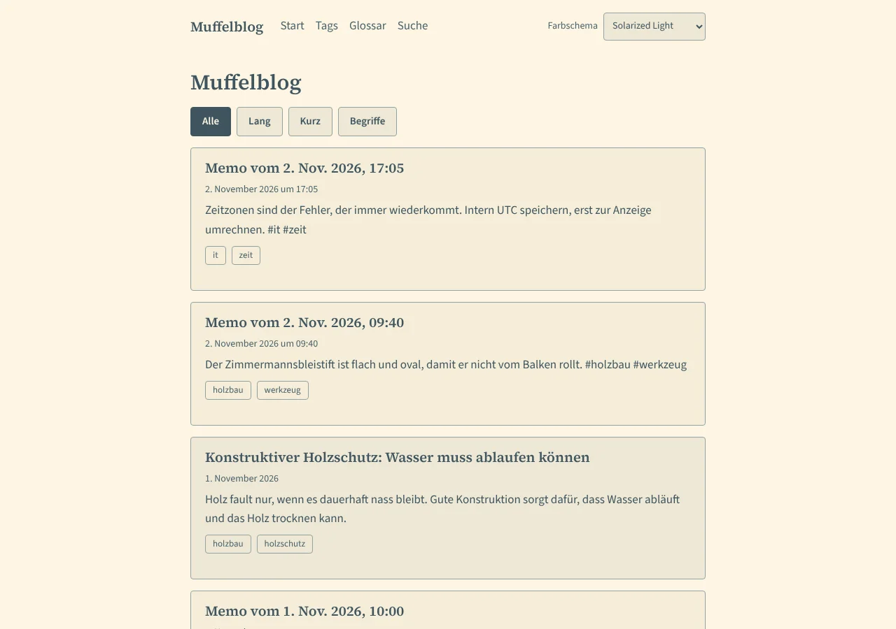
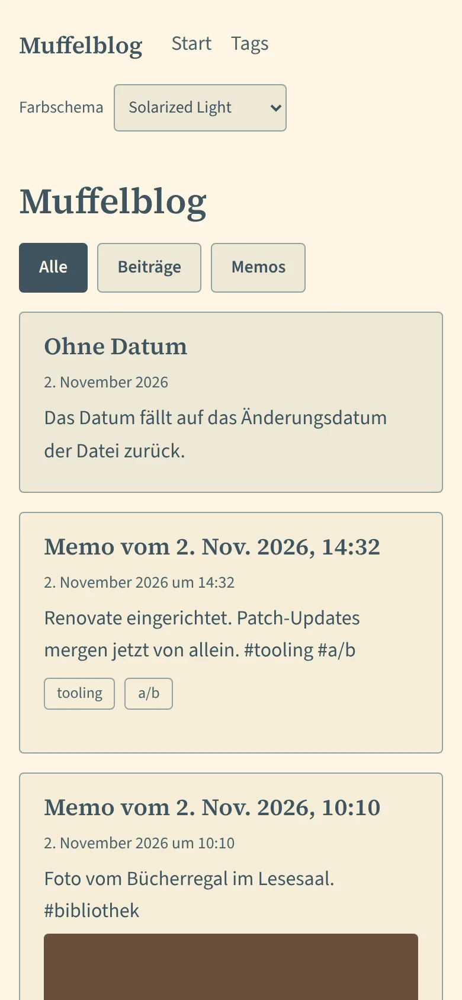
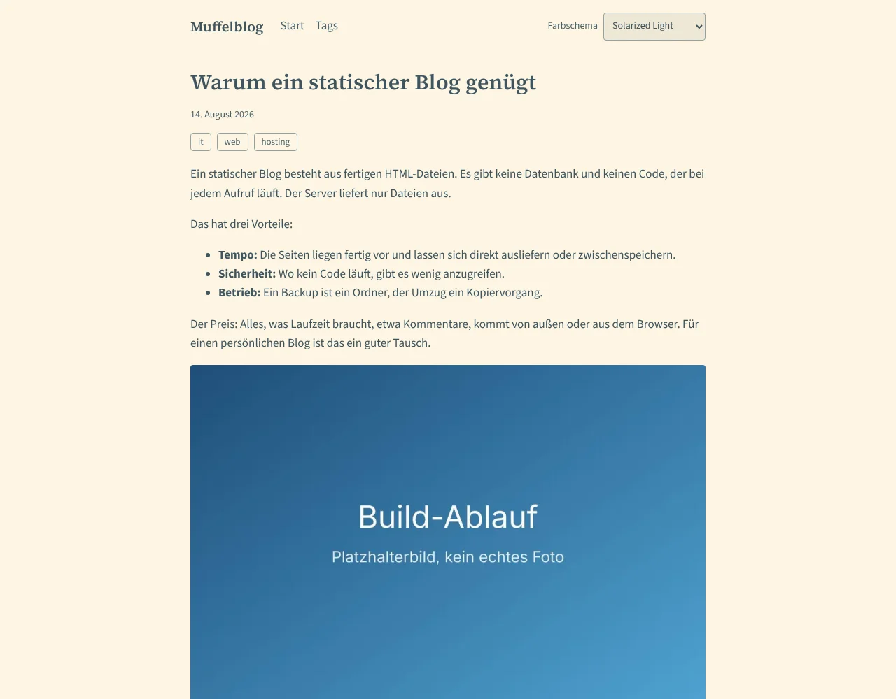
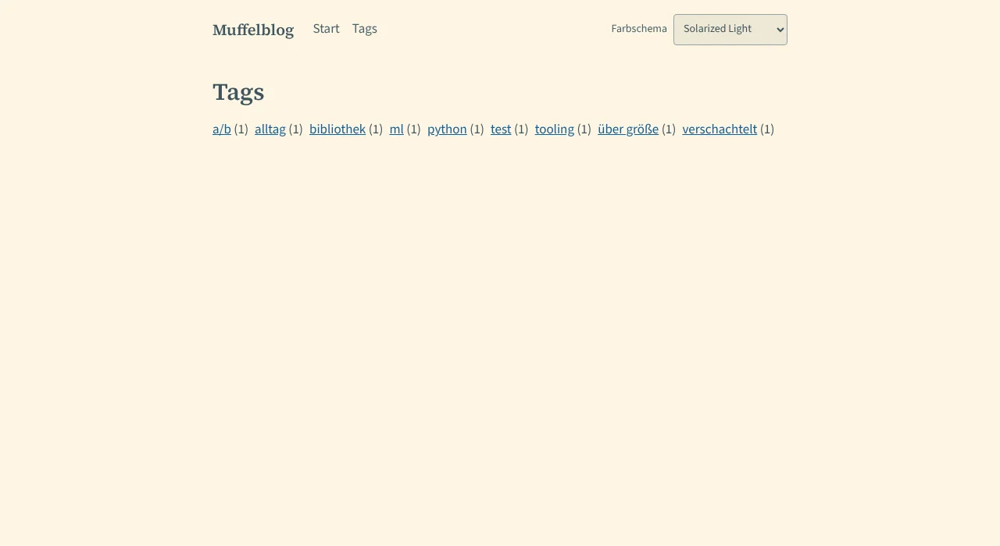
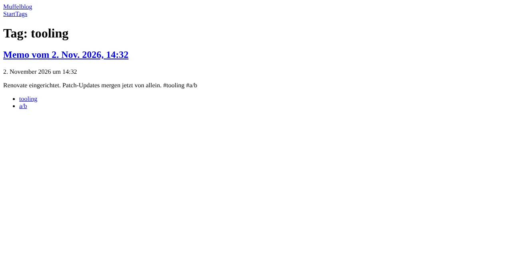

# Muffelblog

Statischer Blog mit Memos-Microblog. Die Spezifikation liegt als OKF-Bundle in
[`okf/`](okf/index.md).

## Vorschau

Zwischenstand mit Beispieldaten, noch ohne Gestaltung (Themes folgen in W06c,
siehe [Roadmap](okf/roadmap.md)). Nextcloud-Anbindung, Betrieb und
Kommentare fehlen noch.

| Feed (breit)                                    | Feed (mobil)                                    |
| ----------------------------------------------- | ----------------------------------------------- |
|  |  |

| Artikel                                   | Tags                                | Tag-Seite                                     |
| ----------------------------------------- | ----------------------------------- | --------------------------------------------- |
|  |  |  |

Die Bilder entstehen aus der gebauten Seite mit Beispieldaten und lassen sich
mit `pnpm screenshots` neu erzeugen (braucht einen Browser, siehe unten).

## Struktur

| Pfad            | Inhalt                                    |
| --------------- | ----------------------------------------- |
| `apps/site`     | Astro-Seite                               |
| `apps/builder`  | Scheduler, Sync und Mention-Jobs (Gerüst) |
| `packages/core` | Gemeinsamer Code von Seite und Builder    |
| `okf/`          | Spezifikation, Roadmap, Entscheidungen    |

## Voraussetzungen

- Node 26 (siehe `.node-version`)
- pnpm 10 (Version in `package.json`)

Corepack gehört seit Node 25 nicht mehr zur Auslieferung. pnpm installierst du
zum Beispiel mit `npm install --global pnpm@10.28.0`.

## Befehle

```sh
pnpm install              # Abhängigkeiten
pnpm lint                 # ESLint
pnpm format:check         # Prettier (pnpm format schreibt)
pnpm typecheck            # tsc und astro check
pnpm test                 # Unit-Tests (Vitest)
pnpm build                # Seite bauen
pnpm test:e2e             # E2E-Tests (Playwright) gegen apps/site/dist
pnpm check                # lint, format:check, typecheck, test und build
pnpm screenshots          # Bilder der README neu erzeugen (docs/screenshots)
```

Für die E2E-Tests braucht Playwright einen Browser:
`pnpm --filter @muffelblog/site exec playwright install chromium`. Alternativ
zeigt `CHROMIUM_PATH` auf ein vorhandenes Chromium.

## Docker

```sh
docker build --target site-dist --output type=local,dest=out .
```

Das schreibt die gebaute Seite nach `out/`.

## CI

`.github/workflows/ci.yml` prüft jeden Pull Request. Der Job **CI Gate** ist
der Pflicht-Check für `main`. Reine Änderungen an `okf/` und an Markdown-Dateien
im Wurzelverzeichnis überspringen die schweren Prüfungen.
