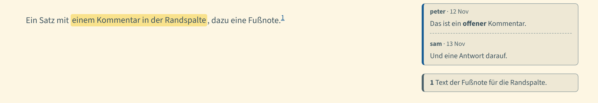
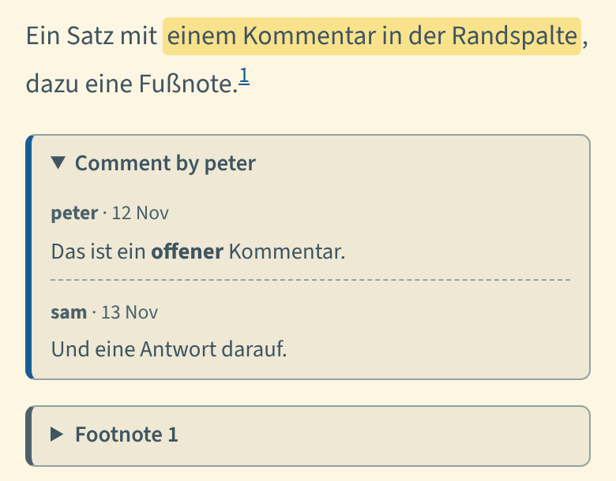

With the Obsidian plugin
[Document Comments](https://github.com/kylemcd/obsidian-document-comments) you
write comments on a passage of a note, like in a text editor with review
functions. The blog shows them **in the margin, next to the paragraph**, and
**footnotes** (`[^1]`) stand there as well, so the reader does not have to scroll
to the end of the page.

On a narrow screen (under 1100 px wide) the notes stand below their paragraph,
closed, and open with a click:

:::caution[Every open comment is public]
The blog publishes **every open comment of a published note, with its whole
thread and the names of all authors**, without any marker. That is meant for a
blog with one author. Mark a comment as **resolved** in the plugin to keep it off
the site; resolved comments never appear.
:::

## Set up the plugin

1. You need Obsidian 1.7.2 or newer.
2. Open **Settings → Community plugins → Browse**, search for **Document
   Comments**, select **Install** and then **Enable**.
3. Open **Settings → Document Comments** and set **Author** to the name that
   should stand next to your comments on the site. Without it the plugin uses `me`.

Nothing has to be set up on the blog's side. The comments are part of the
Markdown file in your Nextcloud folder, like the rest of the note.

## Write a comment

1. Select the text in a note (in Live Preview or Source view).
2. Run **Add comment** from the command palette, or from the right-click menu.
3. Write the comment in the margin and press Enter.

Replies, editing, deleting and resolving work from the comment card in Obsidian.
Markdown in a comment (bold, links, lists) is shown on the site; HTML in it is
dropped.

The plugin stores a comment in the note as HTML comments around the passage and
below the paragraph; other tools that read the file can see them too. The blog
reads exactly these (see the format in the README of the plugin).

## What is shown, and what is not

- **Shown:** every comment with `status:open`, as a card to the right of its
  paragraph, with the highlighted passage in the text. The thread with the dates
  and authors is part of the card.
- **Not shown:** resolved comments (the text of the note stays), comments on
  lines of a fenced code block and comments inside a table (the text stays, the
  comment does not appear).
- **Never:** any other HTML comment you write into a note.
- **Feeds:** the notes are not part of the RSS content or the excerpts.
- **Lists:** a memo in the feed shows no notes; they appear on its own page.

## Footnotes

Footnotes need no plugin: write `[^1]` in the text and `[^1]: The note.` further
down. The note stands in the margin next to its reference **and** in the list at
the end of the post.

A footnote that has more than paragraphs (a list or a code block) stays in the
list at the end only.

## Good to know

- After you save in Obsidian, the change comes through Nextcloud to the blog
  like any other edit; a new build runs after the usual wait (see
  [Connect Nextcloud](/muffelblog/guides/nextcloud/)).
- The format of the plugin is taken from its README. If a plugin update changes
  the format, comments may stop appearing; the text of your notes stays intact.
