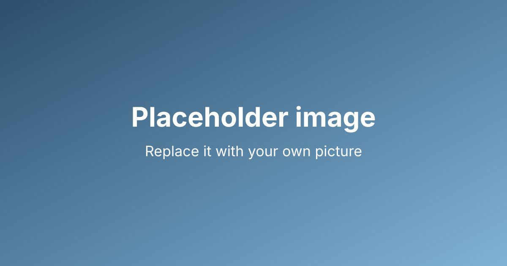

This is the first post of the blog. It is a plain Markdown file in a Nextcloud
folder. When you save it there, the blog notices the change within a few
minutes and builds a new version of the site.

## What you can see here

- **Frontmatter** at the top: `publish: true` makes the file public, `title`,
  `date`, `tags` and `description` describe it. A file without `publish: true`
  stays private, so drafts and notes can live in the same folder.
- **Links** to other sites, like [the IndieWeb page about webmentions](https://indieweb.org/Webmention).
  When the blog is set up to send webmentions, the site you link to is told
  about it.
- **Links to your own pages** use normal Markdown, for example the glossary
  entry [Webmention](/g/webmention/).
- **Images** sit next to the post in a folder and are referenced with a relative
  path. The blog turns them into small, fast WebP files.

## What to do next

Replace this post with your own, and replace the placeholders in the two legal
pages. The folder name and the file names do not matter, only the frontmatter
does.
