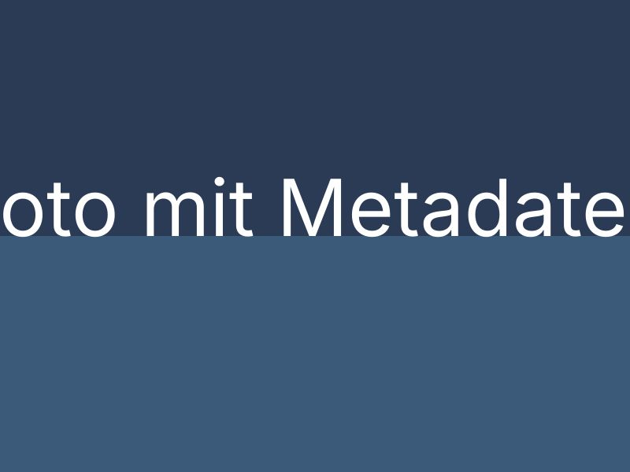

# Abschnitt

Ein Absatz mit **fettem** Text und einem [externen Link](https://example.org/seite).

- Punkt eins
- Punkt zwei

| Name | Wert |
| ---- | ---- |
| a    | 1    |

```ts
const x = 1;
```





<iframe src="https://www.youtube-nocookie.com/embed/dQw4w9WgXcQ" width="560" height="315"></iframe>

## Weiteres

Ein Link auf einen Begriff im Ordner: [Cache](cache.md), und einer auf einen
Entwurf, der Text bleibt: [Entwurf](ohne-publish.md).

Der Zwischenspeicher bleibt Text, weil der Cache oben schon von Hand verlinkt
ist. Der Äther dagegen wird automatisch verlinkt, im Code nicht: `Äther`.

Ein Satz mit <!--c:mn01-->einem Kommentar in der Randspalte<!--/c:mn01-->, dazu eine Fußnote.[^randnotiz]
<!--co:mn01 by:peter at:2026-11-12T10:00:00.000Z status:open quote:"einem Kommentar in der Randspalte"
peter (2026-11-12T10:00:00.000Z): Das ist ein **offener** Kommentar.
sam (2026-11-13T09:00:00.000Z): Und eine Antwort darauf.
-->

Ein <!--c:mn02-->gelöster Kommentar<!--/c:mn02--> bleibt unsichtbar.
<!--co:mn02 by:peter at:2026-11-12T10:00:00.000Z status:resolved
peter (2026-11-12T10:00:00.000Z): erledigt und geheim
-->

[^randnotiz]: Text der Fußnote für die Randspalte.
